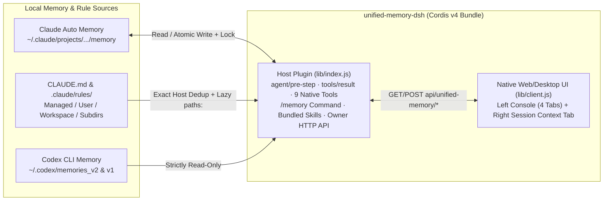

<div align="center">


# Unified Memory for DeepSeek Harness

**One unified memory layer for DeepSeek Harness — bridging Claude Code Auto Memory & Rules (Read-Write) with OpenAI Codex CLI Memory (Strictly Read-Only), plus a native bilingual Web & Desktop Console.**

<p>
  <a href="https://www.npmjs.com/package/unified-memory-dsh"></a>
  
  
  
  
  
  
  <a href="./LICENSE"></a>
</p>

<p>
  <strong>English</strong> · <a href="./README.zh-CN.md">简体中文</a>
</p>

<p>
  <a href="#at-a-glance">At a Glance</a> ·
  <a href="#quick-start">Quick Start</a> ·
  <a href="#how-it-works">How It Works</a> ·
  <a href="#features">Features</a> ·
  <a href="#tools-commands--skills">Tools &amp; Commands</a> ·
  <a href="#configuration">Configuration</a> ·
  <a href="#disclaimer--license">License</a>
</p>

</div>

---

## At a Glance

| Layer | Mode | Source | What It Brings to DeepSeek Harness |
| --- | --- | --- | --- |
| **Claude Auto Memory** | `Read-Write` | `~/.claude/projects/<slug>/memory/` | Exact v2.1.x path slug & Git worktree main-repo mapping, nested `metadata:` frontmatter, shared `.unified-memory.lock` + atomic writes, 200-line / 25 KB `MEMORY.md` cap, pure-CJK topic name safety |
| **`CLAUDE.md` & `.claude/rules/`** | `Read + Lazy` | Managed → User → Ancestor → Project → Local | Exact runtime dedup against `dsh-agent-instructions` (`AGENTS.md`, bare `CLAUDE.md`), `@import` expansion, HTML comment stripping, fail-closed external trust boundary, on-demand `paths:` & subdir `CLAUDE.md` |
| **OpenAI Codex CLI Memory** | `Read-Only` | `~/.codex/memories_v2/` & `memories/` | Startup `memory_summary.md` injection, CJK-friendly search across `rollout_summaries/`, `extensions/ad_hoc/`, `skills/`, and v1 `MEMORY.md` with strict path-jail protection |
| **Native Web & Desktop UI** | `dsh.client` | Left Sidebar Console & Right Session Tab | Live reactive Chinese (`zh`) / English (`en`) switching, `--dsw-*` light/dark theme integration, 4 global console tabs + live per-session context sidebar |

---

## Quick Start

> [!TIP]
> Pre-bundled, zero-dependency artifacts (`lib/index.js` and `lib/client.js`) are committed in this repository with **no `prepare` or `postinstall` script** — installing via `dsh plugin` requires **zero compilation** and **zero pnpm `allowBuilds` prompts**. Compatible with `@deepseek-ai/dsh >=0.2.0 <0.3.0` on **Node.js ≥ 24.9.0**.

### Option 1: Install from npm (Recommended)

Installing via npm unlocks automatic version detection and one-click upgrades inside the Plugins UI.

- **Web / Headless / ACP / SDK CLI**:

  ```bash
  # Install into the `web` profile
  dsh plugin --profile web add unified-memory-dsh

  # Or for headless / acp / sdk profiles (same package adapts automatically)
  dsh plugin --profile headless add unified-memory-dsh
  ```

- **Desktop & Web UI**:
  The CLI restricts `--profile desktop` modifications to the desktop host. Open **Plugins → Install Plugin** in the left sidebar, enter **`unified-memory-dsh`**, and confirm.

### Option 2: Install from GitHub or Offline Release Tarball (`.tgz`)

```bash
# Directly from GitHub (pre-bundled, no build step required)
dsh plugin --profile web add github:A-Cepheus/unified-memory-dsh

# Offline / intranet install from a downloaded GitHub Release `.tgz`
dsh plugin --profile web add /absolute/path/to/unified-memory-dsh-0.1.1.tgz
```

> In Desktop / Web Plugins UI, local `.tgz` paths must be absolute (e.g., `/absolute/path/to/unified-memory-dsh-0.1.1.tgz`). Download prebuilt tarballs from [GitHub Releases](https://github.com/A-Cepheus/unified-memory-dsh/releases).

### Option 3: Local Development Without Installing (`--patch`)

```bash
git clone https://github.com/A-Cepheus/unified-memory-dsh.git
cat > /tmp/um-dev.patch.yml <<'EOF'
- insert:
    - id: unified-memory
      name: /absolute/path/to/unified-memory-dsh
EOF

dsh web --patch /tmp/um-dev.patch.yml
```

Once active in `dsh web` or Desktop, open **Unified Memory** from the **left sidebar**, or inspect active session injections from the **right sidebar** tab. In CLI/headless sessions, run `/memory status`.

---

## How It Works

Unlike shell-hook plugins that spawn external subprocesses on every turn, `unified-memory-dsh` is a **native in-process Cordis v4 Bundle Plugin** with optional Web/Desktop React UI (`lib/client.js`). Optional host services (`systemPrompt`, `commands`, `skills`, `connection`, `settings`) are mounted via separate `ctx.inject(...)` scopes so the exact same package runs cleanly across `web`, `desktop`, `headless`, `acp`, and `sdk` profiles without polluting `stdout`.



### Prompt Cache & Session Lifecycle Discipline

> [!IMPORTANT]
> Built from first principles for maximum KV / Prompt Cache hit rates:
> - **Static System Guidance + Persistent Pre-Step Snapshot**: Static standing memory rules live in `ctx.systemPrompt.section` (`interpolate: false`); dynamic workspace rules & memory indices are spliced once via `ctx.on('agent/pre-step', ..., { prepend: true })` using producer-owned `source: { kind: 'unified-memory', form: 'instructions', baseline: true }` (V4 JSONL compatible, collapsed cleanly as a disclosure row in chat).
> - **Zero Raw Duplication with `dsh-agent-instructions`**: Because `{ prepend: true }` runs after `dsh-agent-instructions` splices its message, `unified-memory-dsh` inspects `source.changes[]` to skip duplicating raw `AGENTS.md` / bare `CLAUDE.md` bodies while still expanding `@import`s, loading `~/.claude/` and `.claude/rules/`, and taking over bare `CLAUDE.md` automatically in presets like `minimal`.
> - **Native Compaction Reload**: Monitors `agent.session.surface.nodes` and `surface.replaceGeneration` — skips on `resume`, automatically reloads refreshed baseline after `/compact` or auto-compaction, and resets lazy-rule deduplication.
> - **100% `subagent_fork` Cache Preservation**: Forked in-process subagents inherit the parent's surface baseline and automatically skip redundant re-injection.
> - **Session-Locked Bilingual Locale**: Resolves `zh` or `en` once per session (and on compaction reload), preventing mid-session language flapping.

---

## Features

### 1. Claude Code Auto Memory (`Read-Write`, v2.1.x Aligned)
- **Exact Project Slug & Git Worktree Resolution**: Matches Claude Code's slug algorithm (`[^a-zA-Z0-9]` → `-`, deterministic base36 hash suffix over 200 chars) and resolves linked Git worktrees back to the main repository root.
- **Dual-Schema Frontmatter**: Reads legacy flat and v2.1.x nested `metadata: { node_type: memory, type, originSessionId, modified }`; writes canonical v2.1.x nested metadata cleanly.
- **Cross-Harness Lock Safety**: Uses the exact same `.unified-memory.lock` file + atomic writes as `unified-memory-antigravity`, preventing race conditions when using both harnesses on the same repo.
- **CJK Topic Name Ergonomics**: Pure Chinese topic names without an explicit `filename` deterministically generate safe ASCII filenames (`topic-<hash>.md`) instead of failing.

### 2. `CLAUDE.md` & `.claude/rules/` (Claude Code Parity)
- **Full Hierarchy**: Loads `Managed → User (~/.claude/CLAUDE.md, ~/.claude/rules/**) → Ancestor → Project → .claude/CLAUDE.md → .claude/rules/** → CLAUDE.local.md`.
- **Smart Parsing & Dedup**: Expands `@import` up to 5 hops (cycle detection, code-fence skipping), strips HTML comments, honors `claudeMdExcludes`, and deduplicates against `dsh-agent-instructions`.
- **Fail-Closed External Trust Boundary**: Repository-provided rules pointing to out-of-workspace `@import`s or rule symlinks are blocked by default until approved by the user in the **Rules & Context** console (owner-only HTTP API, never exposed to model tools) or already approved in `~/.claude.json` (read-only).
- **On-Demand Lazy Loading**: Tracks `read`, `read_image`, `write`, `edit`, `apply_patch`, and `str_replace_editor` (including nested PTC calls) to append matching `paths:` rules and subdirectory `CLAUDE.md` files once per session.

### 3. OpenAI Codex CLI Memory (`Strictly Read-Only`)
- **v2 + v1 Compatibility**: Prefers `~/.codex/memories_v2/` with fallback to `~/.codex/memories/`, automatically stripping the leading `v1` header from `memory_summary.md`.
- **Bilingual Full-Text Search**: Splits on both ASCII and Chinese full-width punctuation with CJK bigram fallback so Chinese and English recall queries match `rollout_summaries/`, `extensions/ad_hoc/`, `skills/`, and chunked v1 `MEMORY.md`.
- **Hard Path Jail & Zero Writes**: Blocks `..`, `.git`, `.codex-baseline`, `raw_memories.md`, `*.sqlite`, and performs zero writes to `~/.codex/`.

### 4. Native Bilingual Web & Desktop Console
- **Left Sidebar Global Console**:
  - **Overview** — Claude & Codex inventory, live config toggles (including `Auto / 简体中文 / English` locale selector), active & recent sessions, and diagnostics.
  - **Claude Memory** — Visual `MEMORY.md` editor with 200-line / 25 KB budget meters + full topic CRUD.
  - **Codex Memory (RO)** — Read-only `memory_summary.md` preview, file browser, and CJK-friendly search.
  - **Rules & Context** — Hierarchy inspector with host-dedup badges, `@import` trees, conditional `paths:` rules, and user-only External Import / Symlink Trust approval controls.
- **Right Sidebar Session Context Tab** — Live snapshot of the active session's resolved locale, baseline status, compaction count, host-deduped rules, and dynamically triggered `paths:` rules.
- **Instant Reactive i18n**: Registers `{ zh, en }` with `@deepseek-ai/dsh-client-locale` and follows `--dsw-*` light/dark host themes automatically.

---

## Tools, Commands & Skills

### 9 Native Host Tools (`ctx.tools`)

All tools automatically resolve the active session's working directory via `ctx.workingDirectory.ensure(...)` (with optional `projectPath` override on Claude memory tools and `workspacePath` override on `claude_rules_inspect`), and read-only tools declare `isConcurrencySafe: () => true` for safe parallel execution.

| Tool | Access | Description |
| --- | --- | --- |
| `claude_memory_status` | Read | Resolve Git worktree main root, slug, `memoryDir`, `MEMORY.md` budget usage, and topic counts |
| `claude_memory_list` | Read | List Claude Auto Memory topic files and `MEMORY.md` preview (optional `type` filter) |
| `claude_memory_read` | Read | Read `MEMORY.md` or a specific topic file with parsed metadata |
| `claude_memory_save` | Write | Atomically create/update a v2.1.x topic memory and sync `MEMORY.md` |
| `claude_memory_delete` | Write | Delete a topic memory and prune its entry from `MEMORY.md` |
| `claude_rules_inspect` | Read | Inspect active `CLAUDE.md`, `@import` chains, host dedup status, external trust summary, and `.claude/rules/` |
| `codex_memory_summary` | Read | Read Codex `memory_summary.md` and generation status (read-only) |
| `codex_memory_search` | Read | Bilingual keyword search across Codex rollouts, extensions, skills, and handbook (read-only) |
| `codex_memory_read` | Read | Read a single path-jailed Codex memory file (read-only) |

### Slash Command & Bundled Skills
- **`/memory [status | list | rules | trust | reload]`** — Zero-token, log-only slash command for instant bilingual status inspection, rule diagnostics, external trust visibility, and on-demand baseline refresh.
- **`memory-manage`** (bundled skill) — Interactive cross-ecosystem memory & rule diagnostics (triggers in both English and Chinese).
- **`memory-dream`** (bundled skill) — Consolidate, deduplicate, and prune stale Claude Auto Memory entries under the 200-line / 25 KB cap.

---

## Configuration

Settings can be configured in `cordis.patch.yml`, in the Plugins settings card (`.volatile()` fields), or live in the **Overview** tab (persisted at `$DSH_HOME/storages/unified-memory/config.json`):

| Key | Default | Description |
| --- | --- | --- |
| `locale` | `"auto"` | Display & injected-header language: `"auto"`, `"zh"`, or `"en"` (`"zh-CN"` accepted and normalized to `"zh"`) |
| `injectCodexSummaryOnStart` | `true` | Inject Codex `memory_summary.md` in baseline context |
| `codexSummaryMaxBytes` | `8192` | Maximum bytes injected from Codex `memory_summary.md` |
| `injectCodexGlobalAgentsMd` | `false` | Also inject `~/.codex/AGENTS.md` (or `AGENTS.override.md`) in baseline |
| `deduplicateNativeAgentsMd` | `true` | Deduplicate native `AGENTS.md` / `AGENTS.local.md` and host-loaded `CLAUDE.md` bodies |
| `trustClaudeCodeExternalApprovals` | `true` | Reuse project-level external include approvals from `~/.claude.json` (read-only) |
| `externalRuleTrust` | `{}` | Per-workspace allow/deny target paths for external `@import`s & rule symlinks (user-only) |
| `maxStartupInjectBytes` | `65536` | Upper bound for combined baseline injection |

### Locale Resolution Priority (`locale: "auto"`)
1. Explicit plugin config (`config.locale !== "auto"`)
2. `UNIFIED_MEMORY_LOCALE` environment variable
3. DeepSeek Harness UI language setting (`ctx.settings` `locale.preference`)
4. POSIX locale (`LC_ALL` → `LC_MESSAGES` → `LANG` → `Intl.DateTimeFormat().resolvedOptions().locale`)
5. Fallback: `"en"` (`zh*` normalizes to `"zh"`)

<details>
<summary><strong>Environment Variables</strong></summary>

| Variable | Default | Purpose |
| --- | --- | --- |
| `DSH_HOME` | `~/.dsh` | DeepSeek Harness home directory (plugin storage lives under `$DSH_HOME/storages/unified-memory`) |
| `UNIFIED_MEMORY_LOCALE` | unset | Override resolved locale (`zh`, `zh-CN`, or `en`) |
| `UNIFIED_MEMORY_DATA_DIR` | `$DSH_HOME/storages/unified-memory` | Custom directory for `config.json`, `sessions/`, and `diagnostics.jsonl` |
| `CLAUDE_CONFIG_DIR` | `~/.claude` | Custom Claude Code configuration root |
| `CLAUDE_CODE_DISABLE_AUTO_MEMORY` | unset | Set `1` or `true` to disable Claude Auto Memory injection & writes |
| `CODEX_HOME` | `~/.codex` | Custom Codex CLI home directory |

</details>

---

## Project Structure & Development

<details>
<summary><strong>Directory Layout</strong></summary>

```text
unified-memory-dsh/
├── package.json            # Bundle manifest (engines.dsh, exports, dsh.bundle, dsh.client)
├── cordis.patch.yml        # Cordis v4 bundle layer (bare package name for ./client discovery)
├── assets/icon.svg         # Plugin vector icon
├── locale/
│   ├── en.json             # English plugin metadata (title, description, detail)
│   └── zh.json             # Chinese plugin metadata
├── docs/
│   ├── DETAIL.md           # English Plugins detail page
│   └── DETAIL.zh.md        # Chinese Plugins detail page
├── scripts/build.mjs       # esbuild bundler (ESM Host lib/index.js + Lazy-CJS Client lib/client.js)
├── src/
│   ├── core/               # Host-agnostic engine (Claude memory/rules, Codex RO, session state, i18n)
│   ├── shared/             # Shared Host <-> Client HTTP API contract & DTOs
│   ├── host/               # Native Cordis v4 Host plugin (context, tools, commands, skills, routes)
│   └── client/             # Native React Web/Desktop UI (Left Console + Right Session Tab)
├── tests/                  # Core unit tests, i18n/CJK tests, and real Cordis v4 E2E integration tests
└── lib/                    # Pre-bundled zero-compile artifacts committed for direct GitHub installs
    ├── index.js
    └── client.js
```

</details>

```bash
npm install
npm run typecheck
npm run build
npm test
```

- **100% Local**: All reading, writing, and indexing run strictly on your local filesystem — zero telemetry, zero external network requests.
- Contributions and issue reports are welcome.

---

## Disclaimer & License

- **Independent Community Project**: `unified-memory-dsh` is an independent open-source project and is not affiliated with, endorsed by, or sponsored by DeepSeek, Anthropic, or OpenAI. All product names and trademarks belong to their respective owners.
- **Local Plaintext Interoperability Only**: This plugin operates exclusively on local plaintext Markdown memory and rule files (`~/.claude/projects/*/memory/`, `CLAUDE.md`, `.claude/rules/`, read-only `~/.codex/memories*`, and `$DSH_HOME/storages/unified-memory/`). It never reads or reuses authentication credentials, API keys, OAuth tokens, or private cloud endpoints.
- **Cross-Model Data Flow Notice**: Local memories injected into a DeepSeek Harness conversation become part of the prompt sent to your configured model provider. If you operate under enterprise data-boundary or DPA policies, verify that sharing local Claude/Codex notes across tools complies with your organization's rules (you can disable Codex startup injection via `injectCodexSummaryOnStart: false` or Claude Auto Memory via `CLAUDE_CODE_DISABLE_AUTO_MEMORY=1`).
- **License**: Released under the [MIT License](./LICENSE).
