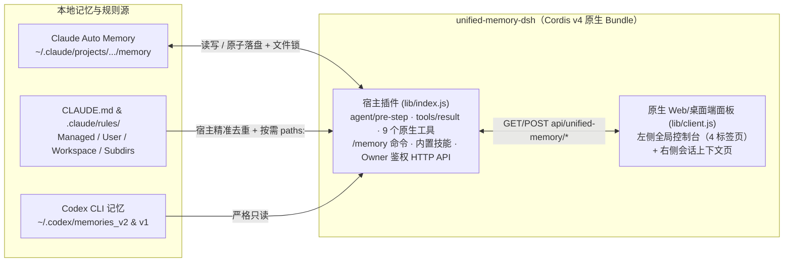

<div align="center">


# Unified Memory for DeepSeek Harness (`dsh`)

**面向 DeepSeek Harness 的统一记忆层 —— 完整打通 Claude Code 自动记忆与规则（读写）和 OpenAI Codex CLI 记忆（严格只读），内置中英双语（`zh` / `en`）原生 Web 与桌面端管理控制台。**

<p>
  
  
  
  
  
  
  <a href="./LICENSE"></a>
</p>

<p>
  <a href="./README.md">English</a> · <strong>简体中文</strong>
</p>

<p>
  <a href="#能力总览">能力总览</a> ·
  <a href="#快速安装">快速安装</a> ·
  <a href="#工作原理">工作原理</a> ·
  <a href="#核心特性">核心特性</a> ·
  <a href="#工具命令与技能">工具与命令</a> ·
  <a href="#配置说明">配置说明</a> ·
  <a href="#免责声明与开源协议">开源协议</a>
</p>

</div>

---

## 能力总览

| 记忆 / 规则层 | 权限模式 | 数据来源 | 为 DeepSeek Harness 带来的能力 |
| --- | --- | --- | --- |
| **Claude Auto Memory** | `读写` | `~/.claude/projects/<slug>/memory/` | 对齐 v2.1.x 路径编码与 Git worktree 主仓解析、嵌套 `metadata:` Frontmatter、共享 `.unified-memory.lock` 文件锁 + 原子写入、`MEMORY.md` 200 行 / 25 KB 截断预算、纯中文主题名安全编码 |
| **`CLAUDE.md` & `.claude/rules/`** | `只读 + 懒加载` | Managed → User → Ancestor → Project → Local | 与 `dsh-agent-instructions` 运行时精准去重（`AGENTS.md`、裸 `CLAUDE.md`）、`@import` 递归展开、HTML 注释剥离、外部导入安全信任边界、`paths:` 与子目录 `CLAUDE.md` 按需注入 |
| **OpenAI Codex CLI 记忆** | `严格只读` | `~/.codex/memories_v2/` 与 `memories/` | 启动注入 `memory_summary.md`，支持中文分词与双字召回的跨会话全文搜索（`rollout_summaries/`、`extensions/ad_hoc/`、`skills/` 与 v1 `MEMORY.md`），路径沙箱零写入 |
| **原生 Web & 桌面端控制台** | `dsh.client` | 左侧边栏全局控制台 & 右侧会话上下文页 | 实时响应式中英双语切换（`zh` / `en`）、自动同步 `--dsw-*` 深浅色主题、四大管理标签页 + 活跃会话记忆追踪 |

---

## 快速安装

> [!TIP]
> 仓库已提交零依赖预构建产物（`lib/index.js` 与 `lib/client.js`），且**不含 `prepare` / `postinstall` 脚本** —— 通过 `dsh plugin` 安装**无需本地编译**，也**无需触发 pnpm `allowBuilds` 弹窗**。兼容 `@deepseek-ai/dsh >=0.2.0 <0.3.0`，需要 **Node.js ≥ 24.9.0**。

### 方式一：安装到 Web / Headless / ACP / SDK Profile（推荐）

```bash
# 从 GitHub 直接安装到 web profile
dsh plugin --profile web add github:A-Cepheus/unified-memory-dsh

# 同样支持 headless / acp / sdk profile（同一插件包自动按能力适配）
dsh plugin --profile headless add github:A-Cepheus/unified-memory-dsh
```

### 方式二：在 DeepSeek Harness 桌面端（Desktop）安装

`dsh` CLI 默认不允许通过命令行修改 `--profile desktop`。请打开 **DeepSeek Harness Desktop → 左侧边栏 Plugins（插件）→ 安装插件**，输入 `github:A-Cepheus/unified-memory-dsh`（或本地目录路径）即可一键安装启用。

### 方式三：本地开发零安装调试（`--patch`）

```bash
git clone https://github.com/A-Cepheus/unified-memory-dsh.git
cat > /tmp/um-dev.patch.yml <<'EOF'
- insert:
    - id: unified-memory
      name: /absolute/path/to/unified-memory-dsh
EOF

dsh web --patch /tmp/um-dev.patch.yml
```

激活后，可在 `dsh web` 或桌面端 **左侧边栏** 打开 **统一记忆（Unified Memory）** 控制台，或在 **右侧边栏** 查看当前会话的实时记忆上下文；在 CLI / Headless 模式下直接输入 `/memory status`。

---

## 工作原理

与每轮拉起外部子进程的 Shell Hook 模式不同，`unified-memory-dsh` 是**进程内原生 Cordis v4 Bundle 插件**（Host `lib/index.js` + 可选 React Client `lib/client.js`）。所有非必需宿主服务（`systemPrompt`、`commands`、`skills`、`connection`、`settings`）均通过独立的 `ctx.inject(...)` 按需挂载，确保同一插件包在 `web`、`desktop`、`headless`、`acp`、`sdk` 全部 5 种 Profile 下零报错运行且严格保持 `stdout` 纯净。



### Prompt Cache 与会话生命周期设计

> [!IMPORTANT]
> 从底层架构保障高 Prompt Cache / KV Cache 命中率：
> - **静态指引 + 持久化基线快照**：不变的全局记忆纪律通过 `ctx.systemPrompt.section`（`interpolate: false`）注入；工作区相关的规则与记忆索引在 `ctx.on('agent/pre-step', ..., { prepend: true })` 中以插件自有来源 `source: { kind: 'unified-memory', form: 'instructions', baseline: true }` 注入（完全通过 V4 JSONL 校验，聊天界面自动折叠为披露条）。
> - **与 `dsh-agent-instructions` 精准零重复**：借助 `{ prepend: true }` 捕获宿主已拼接的 `source.changes[]`，自动跳过 `AGENTS.md` 与裸 `CLAUDE.md` 正文重复注入，同时继续展开 `@import` 链、加载 `~/.claude/` 与 `.claude/rules/`，并在 `minimal` 等未启用宿主规则的预设下自动完整接管 `CLAUDE.md`。
> - **原生 `/compact` 压实自动重载**：监听 `agent.session.surface.nodes` 与 `surface.replaceGeneration` —— 会话恢复（`resume`）绝不重复注入，压实后自动重载最新基线并重置懒加载去重集。
> - **`subagent_fork` 100% 复用父会话缓存**：进程内派生（`fork`）子代理自动识别继承自父会话表面的基线节点，跳过重复注入。
> - **会话级语言锁定**：每段会话在首次基线注入时锁定解析后的语言（`zh` / `en`），直到 `/compact` 或新会话才重新评估，杜绝中途语言抖动破坏缓存。

---

## 核心特性

### 1. Claude Code 自动记忆（`读写`，对齐 v2.1.x）
- **精确项目编码与 Worktree 解析**：复刻 Claude Code 路径 slug 编码（`[^a-zA-Z0-9]` → `-`，超 200 字符附加确定性 base36 哈希后缀），并将 Git worktree 正确映射回主仓库根目录。
- **双 Schema Frontmatter 兼容**：读取兼容旧版扁平 Frontmatter 与最新 v2.1.x 嵌套 `metadata: { node_type: memory, type, originSessionId, modified }`；写入统一生成规范 v2.1.x 格式。
- **跨宿主并发文件锁**：沿用与 `unified-memory-antigravity` 完全一致的 `.unified-memory.lock` 锁文件与原子落盘，多工具同时读写同一项目记忆安全无冲突。
- **中文主题名友好**：未指定文件名时，纯中文主题名自动生成确定性安全 ASCII 文件名（`topic-<hash>.md`），不会因字符过滤报错。

### 2. `CLAUDE.md` 与 `.claude/rules/`（对齐 Claude Code 语义）
- **完整层级加载**：按 `Managed → User（~/.claude/CLAUDE.md、~/.claude/rules/**）→ Ancestor → Project → .claude/CLAUDE.md → .claude/rules/** → CLAUDE.local.md` 顺序加载。
- **智能解析与去重**：支持最多 5 跳 `@import` 展开（循环检测 + 代码块跳过）、剥离 HTML 注释、应用 `claudeMdExcludes`，并与 `dsh-agent-instructions` 运行时精准去重。
- **外部导入与软链默认拦截**：仓库级规则指向工作区外部的 `@import` 或规则符号链接默认阻止，仅在用户于 **规则与上下文** 面板手动批准（仅限 Owner HTTP 接口，对模型不可见）或只读复用 `~/.claude.json` 已批准记录后才放行。
- **按需懒加载**：监听 `read`、`read_image`、`write`、`edit`、`apply_patch` 与 `str_replace_editor`（兼容 PTC 嵌套调用），命中的 `paths:` 规则和子目录 `CLAUDE.md` 在单会话内仅追加注入一次。

### 3. OpenAI Codex CLI 记忆（`严格只读`）
- **v2 + v1 双代兼容**：优先读取 `~/.codex/memories_v2/` 并自动回退至 `~/.codex/memories/`，自动剔除 `memory_summary.md` 首行 `v1` 版本标记。
- **中英双语全文检索**：内置中文全角标点切分与双字（bigram）回退匹配，精准召回 `rollout_summaries/`、`extensions/ad_hoc/`、`skills/` 与分块 v1 `MEMORY.md`。
- **绝对只读路径沙箱**：硬拦截 `..`、`.git`、`.codex-baseline`、`raw_memories.md`、`*.sqlite`，对 `~/.codex/` 零写入。

### 4. 原生中英双语 Web & 桌面端控制台（`zh` / `en`）
- **左侧边栏全局控制台**：
  - **总览（Overview）** — Claude / Codex 记忆资产总览、实时配置开关（含 `自动 / 简体中文 / English` 语言切换）、活跃与近期会话及诊断日志。
  - **Claude 记忆** — `MEMORY.md` 可视化编辑（附 200 行 / 25 KB 预算进度条）与主题记忆完整增删改查。
  - **Codex 记忆（只读）** — `memory_summary.md` 预览、目录浏览与中英文全文搜索。
  - **规则与上下文** — 查看 `CLAUDE.md` 层级、宿主去重标识、`@import` 依赖链、条件 `paths:` 规则以及仅用户可操作的外部信任授权面板。
- **右侧边栏会话上下文面板** — 实时展示当前活跃会话的解析语言、基线状态、压实重载次数、宿主去重文件及已触发的懒加载规则。
- **即时响应式双语与主题**：接入 `@deepseek-ai/dsh-client-locale` 注册 `{ zh, en }`，自动跟随宿主 `--dsw-*` 深浅色主题。

---

## 工具、命令与技能

### 9 个原生宿主工具（`ctx.tools`）

所有工具自动通过 `ctx.workingDirectory.ensure(...)` 感知当前会话工作区（Claude 记忆工具支持可选 `projectPath` 覆盖，`claude_rules_inspect` 支持可选 `workspacePath` 覆盖）；所有只读工具均声明 `isConcurrencySafe: () => true`，支持与读写工具安全并发调度。

| 工具名 | 权限 | 说明 |
| --- | --- | --- |
| `claude_memory_status` | 只读 | 解析 Git worktree 主仓库根、项目 slug、`memoryDir`、`MEMORY.md` 预算与主题统计 |
| `claude_memory_list` | 只读 | 列出 Claude Auto Memory 主题文件与 `MEMORY.md` 索引预览（支持按 `type` 筛选） |
| `claude_memory_read` | 只读 | 读取 `MEMORY.md` 或指定主题记忆文件及其元数据 |
| `claude_memory_save` | 写入 | 以 v2.1.x 格式原子创建/更新主题记忆并同步 `MEMORY.md` |
| `claude_memory_delete` | 写入 | 删除主题记忆并同步清理 `MEMORY.md` 对应条目 |
| `claude_rules_inspect` | 只读 | 检查工作区生效的 `CLAUDE.md`、`@import` 链、宿主去重状态、外部信任摘要与 `.claude/rules/` |
| `codex_memory_summary` | 只读 | 读取 Codex `memory_summary.md` 全局摘要与代次状态（只读） |
| `codex_memory_search` | 只读 | 中英双语关键词检索 Codex rollout、扩展笔记、技能与手册（只读） |
| `codex_memory_read` | 只读 | 读取路径沙箱内的单个 Codex 记忆文件（只读） |

### Slash 命令与内置技能
- **`/memory [status | list | rules | trust | reload]`** —— 仅日志记录、零 Token 与 KV-Cache 开销的交互命令，随时查看中英文状态、规则诊断、外部信任项或预约下轮重载基线。
- **`memory-manage`**（内置技能）—— 交互式跨生态记忆与规则排查工作流（支持中英双语触发）。
- **`memory-dream`**（内置技能）—— 整理、去重与清理过期 Claude 记忆，保持 `MEMORY.md` 在 200 行 / 25 KB 预算内。

---

## 配置说明

可通过 `cordis.patch.yml`、Plugins 设置卡片（`.volatile()` 字段）或在 **总览** 标签页实时修改（持久化于 `$DSH_HOME/storages/unified-memory/config.json`）：

| 配置项 | 默认值 | 说明 |
| --- | --- | --- |
| `locale` | `"auto"` | 界面与注入横幅语言：`"auto"`、`"zh"` 或 `"en"`（兼容 `"zh-CN"` 并自动归一化为 `"zh"`） |
| `injectCodexSummaryOnStart` | `true` | 是否在基线上下文中注入 Codex `memory_summary.md` |
| `codexSummaryMaxBytes` | `8192` | 启动注入 Codex `memory_summary.md` 的最大字节数 |
| `injectCodexGlobalAgentsMd` | `false` | 是否同时注入 `~/.codex/AGENTS.md`（或 `AGENTS.override.md`） |
| `deduplicateNativeAgentsMd` | `true` | 是否对宿主原生加载的 `AGENTS.md` / `AGENTS.local.md` 与裸 `CLAUDE.md` 正文去重 |
| `trustClaudeCodeExternalApprovals` | `true` | 是否只读复用 `~/.claude.json` 中已在 Claude Code 批准的项目外部导入授权 |
| `externalRuleTrust` | `{}` | 按工作区保存的外部 `@import` / 规则软链白名单与黑名单（仅限用户操作） |
| `maxStartupInjectBytes` | `65536` | 基线合并注入内容的总字节上限 |

### 语言解析优先级（`locale: "auto"`）
1. 插件显式配置（`config.locale !== "auto"`）
2. 环境变量 `UNIFIED_MEMORY_LOCALE`
3. DeepSeek Harness 宿主界面语言设置（`ctx.settings` 中的 `locale.preference`）
4. POSIX 系统语言（`LC_ALL` → `LC_MESSAGES` → `LANG` → `Intl.DateTimeFormat().resolvedOptions().locale`）
5. 回退值：`"en"`（所有 `zh*` 归一化为 `"zh"`）

<details>
<summary><strong>支持的环境变量</strong></summary>

| 环境变量 | 默认值 | 说明 |
| --- | --- | --- |
| `DSH_HOME` | `~/.dsh` | DeepSeek Harness 主目录（插件持久化目录为 `$DSH_HOME/storages/unified-memory`） |
| `UNIFIED_MEMORY_LOCALE` | 未设置 | 强制指定插件语言（`zh`、`zh-CN` 或 `en`） |
| `UNIFIED_MEMORY_DATA_DIR` | `$DSH_HOME/storages/unified-memory` | 自定义 `config.json`、`sessions/` 与 `diagnostics.jsonl` 目录 |
| `CLAUDE_CONFIG_DIR` | `~/.claude` | 自定义 Claude Code 配置目录 |
| `CLAUDE_CODE_DISABLE_AUTO_MEMORY` | 未设置 | 设为 `1` 或 `true` 禁用 Claude Auto Memory 注入与写入 |
| `CODEX_HOME` | `~/.codex` | 自定义 Codex CLI 根目录 |

</details>

---

## 目录结构与开发

<details>
<summary><strong>目录结构</strong></summary>

```text
unified-memory-dsh/
├── package.json            # DSH Bundle 清单（engines.dsh、exports、dsh.bundle、dsh.client）
├── cordis.patch.yml        # Cordis v4 Bundle 层（裸包名确保 ./client 自动发现）
├── assets/icon.svg         # 插件矢量图标
├── locale/
│   ├── en.json             # 英文插件元数据（title、description、detail）
│   └── zh.json             # 中文插件元数据
├── docs/
│   ├── DETAIL.md           # 英文 Plugins 详情页
│   └── DETAIL.zh.md        # 中文 Plugins 详情页
├── scripts/build.mjs       # esbuild 打包脚本（ESM Host lib/index.js + Lazy-CJS Client lib/client.js）
├── src/
│   ├── core/               # 宿主无关核心引擎（Claude 记忆/规则、Codex 只读、会话状态、双语 i18n）
│   ├── shared/             # Host <-> Client 共享 HTTP API 契约与 DTO 类型
│   ├── host/               # 原生 Cordis v4 宿主插件（上下文注入、工具、命令、技能、HTTP 路由）
│   └── client/             # 原生 React Web/桌面端 UI（左侧控制台 + 右侧会话面板）
├── tests/                  # 核心单元测试、双语/CJK 测试与真实 Cordis v4 端到端集成测试
└── lib/                    # 预构建零编译产物（提交至仓库，支持 GitHub 直接安装）
    ├── index.js
    └── client.js
```

</details>

```bash
npm install
npm run typecheck
npm run build
npm test
```

- **100% 本地运行**：所有读写与检索均在本地文件系统完成，无遥测、无外部网络请求。
- 欢迎提交 Issue 与 Pull Request。

---

## 免责声明与开源协议

- **独立社区项目**：`unified-memory-dsh` 为独立开源项目，与 DeepSeek、Anthropic 或 OpenAI 无隶属、背书或赞助关系；文中提及的产品名与商标归各自所有者所有。
- **仅限本地明文文件互操作**：本插件仅读写用户本机硬盘上的明文 Markdown 记忆与规则文件（`~/.claude/projects/*/memory/`、`CLAUDE.md`、`.claude/rules/`、严格只读的 `~/.codex/memories*` 以及 `$DSH_HOME/storages/unified-memory/`），**绝不**读取或复用任何账号凭据、API Key、OAuth Token 或私有云端接口。
- **跨模型数据流提示**：被注入到 DeepSeek Harness 会话中的本地记忆会随对话上下文发送至当前配置的模型服务商。若你处于企业数据隔离或 DPA 合规约束环境下，请先确认跨工具共享本地笔记符合所在组织政策（可在配置中设 `injectCodexSummaryOnStart: false` 关闭 Codex 注入，或设置 `CLAUDE_CODE_DISABLE_AUTO_MEMORY=1` 禁用 Claude 自动记忆注入）。
- **开源协议**：基于 [MIT License](./LICENSE) 发布。
